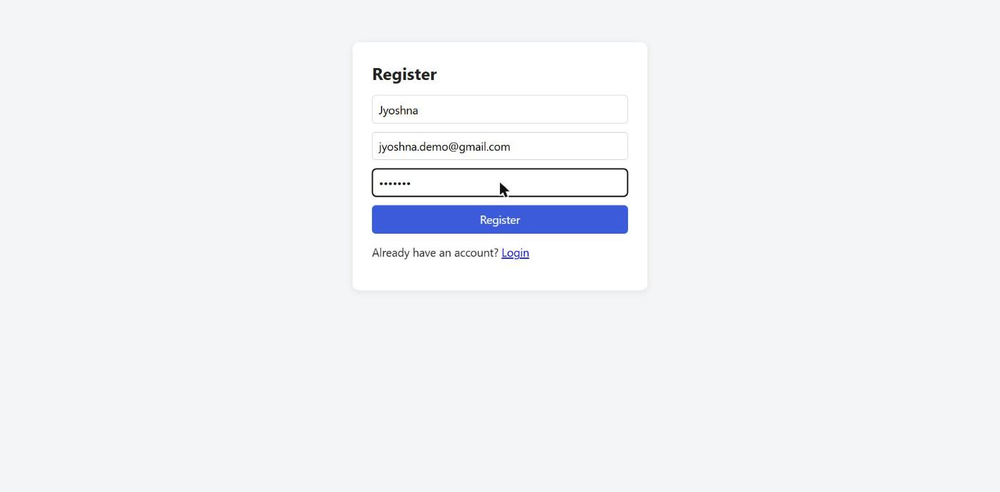
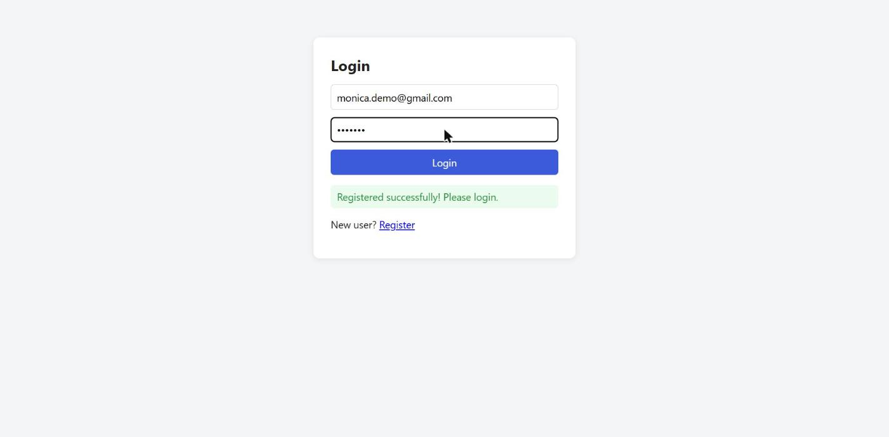
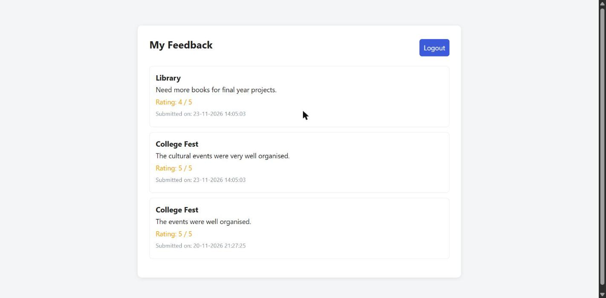
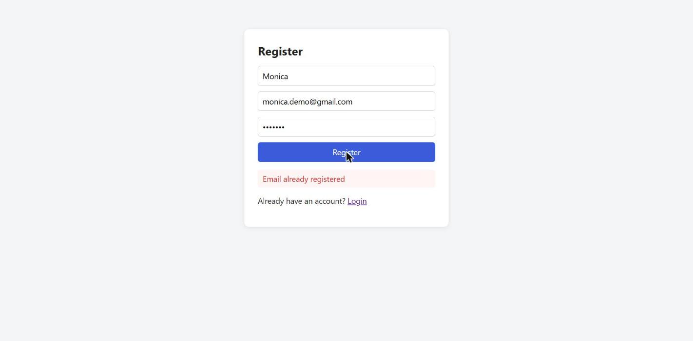
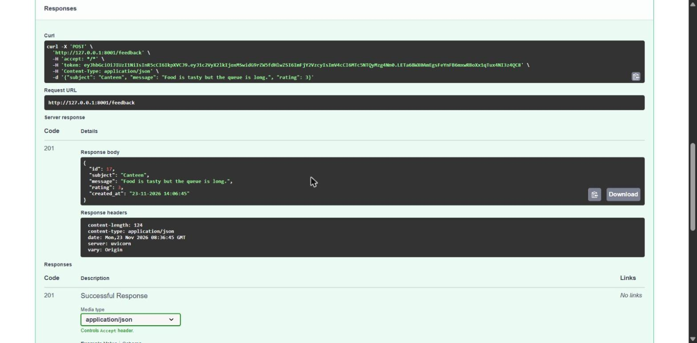
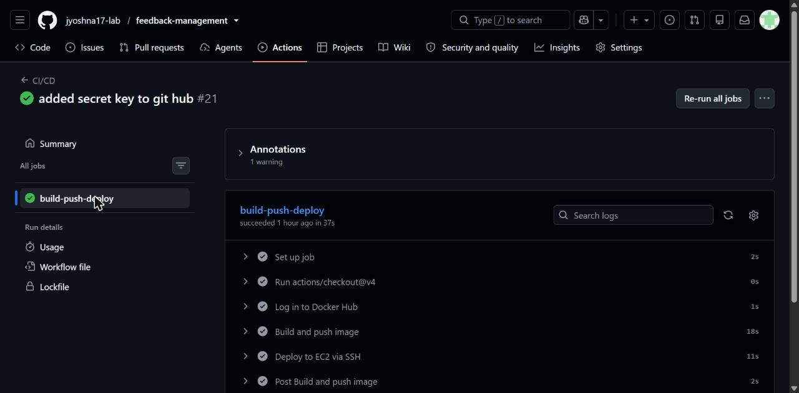

# Feedback Management System

## 1. Project and team

Project name: Feedback Management System

In this project a user can register, login and give feedback about any service, event or experience. After login the user can see the feedback they gave. One user cannot see another user's feedback.

Backend is done in FastAPI with SQLite database and frontend is done in React. Backend is deployed on AWS EC2 using Docker and GitHub Actions.

Team members:

| Name | Roll No | Endpoints we built | Other work |
|---|---|---|---|
| Jyoshna | AU25UG026 | A1 - POST /register, A2 - POST /login | created the repo, database tables, password hashing, create token, dockerfile, login page |
| Monica | AU25UG037 | A3 - POST /refresh, E1 - GET /feedback | checking the token, refresh token in frontend, dashboard page, logout, EC2 and GitHub Actions,readme |
| Madiha | AU25UG078 | E2 - POST /feedback | feedback validation, register page|

## 2. Live app

EC2 link: [http://13.232.217.30:8001/docs](http://13.232.217.30:8001/docs)

## 3. How to run it

### Backend

First create this folder because our database is saved inside it

```
mkdir C:\app\data
```

Then run these commands

```
cd backend
python -m venv venv
venv\Scripts\activate
pip install -r requirements.txt
$env:SECRET_KEY = "any-key"
uvicorn main:app --reload --port 8001
```

Now open http://127.0.0.1:8001/docs

Note: we did not write the secret key in the code, so we have to give it in the terminal before running uvicorn. On EC2 it is taken from GitHub secrets.

### Frontend

Open one more terminal and run

```
cd frontend
npm install
npm run dev
```

Now open http://localhost:5173

### Docker

Run from the project folder

```
docker build -t feedback-api -f backend/dockerfile ./backend
docker run -d -p 8001:8001 -v ${PWD}/data:/app/data -e SECRET_KEY=any-key feedback-api
```

Now open http://127.0.0.1:8001/docs (stop uvicorn before this because both use port 8001)

### Deployment

Whenever we push to main branch, GitHub Actions builds the docker image, pushes it to Docker Hub and runs the new container on EC2. The database is stored in /opt/feedback/data on EC2 and connected to the container using `-v /opt/feedback/data:/app/data`, so old data is not lost when the container is replaced.

## 4. API contract

| No | What it does | Method | Path | Request body | Success code |
|---|---|---|---|---|---|
| A1 | Register new user | POST | /register | username, email, password | 201 |
| A2 | Login and get access and refresh token | POST | /login | email, password | 200 |
| A3 | Get new access token using refresh token | POST | /refresh | refresh token in header (refresh-token) | 200 |
| E1 | Get feedback of logged in user | GET | /feedback | access token in header (token) | 200 |
| E2 | Submit new feedback | POST | /feedback | subject, message, rating and access token in header (token) | 201 |

Error rules:

| Rule | Status |
|---|---|
| Registering with an email that already exists | 409 |
| Login with wrong email or password | 401 |
| Invalid or expired access token | 401 |
| Invalid or expired refresh token | 401 |
| Accessing feedback without token | 401 |
| Missing or empty fields | 422 |
| Invalid email format | 422 |
| Rating below 1 or above 5 | 422 |

## 5. Database

We used one SQLite file feedback.db with two tables.

users table - id, username, email, hashed_password, created_at

feedback table - id, user_id, subject, message, rating, created_at

Password is stored after hashing with argon2. user_id in the feedback table tells which user gave that feedback.

## 6. Screenshots


Register page


Login page


Dashboard showing the feedback of the logged in user


Error message when we register with same email again


POST /feedback working in /docs


GitHub Actions run successful

## 7. Known issues

- We did not add a form in frontend to submit feedback, so feedback is added from /docs
- If we refresh the browser page the user gets logged out
- Only backend is deployed on EC2, frontend runs on our laptop
- If the EC2 instance is stopped and started again the IP changes, so we have to update it in GitHub secrets

If we had more time we would add:

- feedback form in the dashboard
- edit and delete feedback
- deploy frontend also on EC2

## Demo video

https://drive.google.com/drive/folders/1-wiJsdM1pd9xdi5dWZc6wDMp-kbZqvMP?usp=sharing
